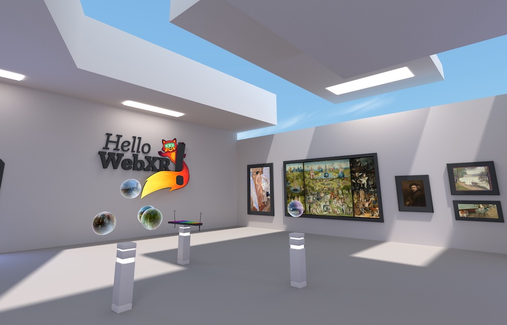

# webxr-simulator

## Hello WebXR!



[Try it here!](https://mixedreality.mozilla.org/hello-webxr/index.html)

This is a WebXR demo made to celebrate the [WebXR spec](https://immersive-web.github.io/webxr/) release at the end of 2019. It showcases several small experiences, perfect to test different kind of interactions and situations in Virtual Reality. For newcomers, it's a nice entry point to the medium, and web developers may find many things they can reuse and learn (more info on the [launch article](https://blog.mozvr.com/hello-webxr)).

## How to build

1. `npm install`
2. `npm start`
3. Open `https://localhost:8080`

Use Node.js 24 or later. On Windows PowerShell, use `npm.cmd install`, `npm.cmd start`, `npm.cmd test`, and `npm.cmd run build` if script execution is disabled. SQLite uses Node's built-in module; no separate database service or extra dependency is required. The launcher preserves the existing webpack 4 and Three.js runtime.

## Visual scene editor

Open `https://localhost:8080/editor` to edit. The public page at `https://localhost:8080/` loads the most recently saved SQLite project without editor buttons or a project ID in its URL. Only the `/editor` path enables authoring; the old `?editor` query does not. The editor works on the original scene and keeps its WebXR renderer, controllers, teleportation, portals, painting, audio and xylophone systems. **Probar** returns to the original desktop/VR experience; **Volver al editor** resumes authoring within `/editor`.

- Browse the hierarchy, select objects in the viewport, and move, rotate or scale them with the gizmo or numeric inspector. Right-drag orbits, middle-drag pans, and the wheel zooms. Hold `W`/`S` to fly forward/backward along the view direction, including height when looking up or down; `A`/`D` move sideways. Hold `Q` to raise the editor camera or `E` to lower it along the world's vertical axis, regardless of the viewing direction. Camera movement keeps its collision checks. Each press of `Space` cycles **Mover → Rotar → Escalar**; holding it does not cycle repeatedly. `F` focuses the selection. Navigation pauses while typing, opening a dialog, loading a project or dragging the gizmo.
- Editor navigation, orbit, pan and zoom collide with visible solid geometry. The desktop visitor uses a capsule, and WebXR resolves tracked movement by adjusting the camera rig while preserving the headset pose and crouching height. Teleport destinations require room for the visitor and turn red when occupied. The collision world uses triangles and a cached geometry hierarchy, preserving the hollow interiors of combined building meshes. Hidden meshes, replaced geometry, sky/panorama backgrounds and nonphysical helpers are excluded. Sensors default to triggers; generated conveyor packages are physical obstacles.
- Add **Colisiones** in **Funciones / componentes** to override an object's default: **Sólido** blocks movement; **Disparador** allows passage. Disabling this component also allows passage. Settings inherit through the object's children and survive copying, JSON and SQLite. Manual gizmo/numeric placement remains free for scene composition; collisions constrain navigation and simulated movement.
- Browse project assets using real thumbnails for images (including Basis) and 3D models, saved Blender thumbnails, and snippets for text/data files. Audio and video have distinct type cards and open playback controls on selection; browsing never starts playback. Filter by type or folder and import files. Double-click or drag a model or image into the viewport to place it. GLB/glTF, OBJ+MTL and FBX models are supported by the editor. Import glTF files together with their `.bin` files and textures. Images create independent picture planes.
- Thumbnails load only for visible cards, with a bounded cache and one shared thumbnail renderer. They release their resources on **Probar**/VR and never load on the public page. Selecting another file or leaving the editor also cancels pending detailed previews.
- `.blend` files show their saved preview image, extracted during catalog generation without opening Blender or downloading the entire source in the browser. **Ver modelo 3D exportado** opens the corresponding GLB/glTF when a unique matching export exists. Blender sources must be exported to a web model format before placement. Sources without a saved thumbnail or a matching export, and other unsupported types, show format details and a download link.
- To add a decal, select an image and press **+ Colocar decal**, then click a wall, floor or object. **+ Decal** in the hierarchy guides you to the image library. `Esc` cancels placement. Transparent PNG images retain their alpha; other image formats, including Basis, use the same image loader as the scene.
- **DECAL · IMAGEN PROYECTADA** edits its image, target, width, height, projection depth, opacity and tint. Move, rotate or scale its projector with the gizmo, or use **Volver a colocar sobre superficie** to align it to another surface. Copy/paste, duplication, undo/redo, JSON and SQLite retain the projector's properties. Decals are visible in the public scene and WebXR and let existing clicks, painting and teleportation reach the underlying surface.
- A decal is a projection volume: moving the projector or changing rigid target geometry recalculates its clipped surface mesh. It stays at its authored location when the target moves out of the volume. Skinned/morph deformation and physically based normal/roughness decal layers are outside this implementation. Generated geometry/textures are private runtime resources, excluded from saved scene data and collision solids.
- Create primitive shapes or choose **Base vacía** for a floor with native VR teleportation. **Restaurar** recovers the current original room. Both operations can be undone.
- Configure custom-object actions in the inspector: change room, show/hide an object, play audio, display an information card in 3D, or enable VR teleportation on a surface. Existing objects keep their original behaviors and protected names. Removing an original object hides it while preserving its runtime references.
- **Funciones / componentes** shows the selected object's native functions and editable parameters: portal destination and trigger, float speed, painting zoom, graffiti brush, xylophone audio, grabbing, information text, billboard orientation, sound, model animation, news and VR teleportation. Expand **Ver configuración y código** to inspect the saved settings and read the implementation. Functions can be enabled, disabled, added, removed or restored to their original settings.
- **Copiar funciones** / **Pegar funciones** transfers component settings to another object. **Copiar función** transfers one component. Pasting replaces settings for matching component types and keeps unrelated components on the target.
- **Duplicar con funciones** / `Ctrl+D` copies original or custom objects, including editable child components. Each copy creates its own audio, animation, paint canvas and controller bindings. Duplicating the xylophone includes its child notes; duplicate a baqueta separately when needed.
- **Copiar objeto** / `Ctrl+C` stores the selected object's current model, visual replacement, transform, appearance, interactions, components and editable children. **Pegar objeto** / `Ctrl+V` creates an independent instance in the active room, even after the source is edited or removed. Each paste gets fresh identities, remaps internal sensor/PLC/control links and offsets the copy by 0.5 m from the previous one. Imported model files retain their existing asset references. Copy/paste participates in undo/redo and saving. The object clipboard belongs to this editor tab and clears when opening/importing a project; text fields keep their regular copy/paste shortcuts.
- Click an information panel or its letters to select the entire panel. **TEXTO DEL PANEL** at the top of the inspector edits its title, multiline text, font size and color; changes appear when the field loses focus. Original and copied panels preview their text during editing and keep independent settings after saving. Use `Ctrl+C` / `Ctrl+V` outside a text field to copy the complete panel.
- **Modelo visual → Reemplazar** (or **Usar** the asset selected in the browser) changes the model while keeping the logical object, functions, placement and native references. **Restaurar modelo** restores the original visual without resetting function settings. Original colliders and native references are retained; animation clips require a compatible model, and painting requires UV coordinates.
- **Guardar** / `Ctrl+S` saves a project on this server in SQLite. **Proyectos** lists saved projects, creates new projects, saves named copies and opens earlier versions. Each successful save appends a revision. Pending edits are saved before switching projects. Changes from another editor window cause a conflict instead of silently overwriting that window's work; **Guardar copia** preserves the current edits under a new project.
- The editor restores the most recently opened project on the next visit in this browser. An editor with no project pointer or local draft opens the most recently saved SQLite project, so a fresh browser can see the same saved scene. An explicit `/editor?project=<id>` link selects that project. **Compartir enlace** saves pending edits and provides an editing link to the current project and room for another tab/browser. The toolbar shows the active project name and revision. Share `/` for the public WebXR walkthrough; it uses the latest saved scene instead of browser drafts.
- Clean editor tabs check saved revisions every five seconds and when focused; tabs in the same browser also receive save notifications. A tab bound to one project never switches to another project automatically. Local drafts, pending imports, dragging/typing, historical versions and active desktop/VR walkthroughs are protected; an available revision appears as **Actualizar · v…** in the editor. Keep local changes with **Proyectos → Guardar copia** before choosing a conflicting saved revision. A pristine editor opened before the first project was saved can discover that project automatically.
- **↓ JSON** downloads the scene configuration with every imported file embedded, including files fetched from server storage. **Importar JSON** opens that standalone backup as a new unsaved project. Existing browser-only saves are recovered when no server project is selected; press **Guardar** to migrate them. Original assets remain referenced by their project paths, so the JSON is intended for this project and is not a standalone website.
- `Ctrl+Z` undoes; `Ctrl+Shift+Z`/`Ctrl+Y` redoes; `Ctrl+C` copies an object; `Ctrl+V` pastes it; `Ctrl+D` duplicates the selected object with its functions; `Delete` removes/hides; `Ctrl+S` saves.

Each room, including the five panoramas, has its own layout. As in the original demo, starting a VR session starts in the main hall; its portals lead to the other edited rooms. Editing uses a separate camera and pauses native scene updates; entering VR restores the original camera and controller flow.

After adding files directly under `assets/`, run `npm run assets:catalog` (or restart the development server). The catalog is also regenerated before builds. It lists project assets, including their Blender sources, rather than application dependencies.

The editor assembles scenes; mesh topology editing stays in Blender. Native lightmaps remain baked. The graffiti activation area follows the wall's transform, including duplicated surfaces. A model imported from the asset browser starts as a visual asset; assign components or paste functions to give it behavior. **Duplicar con funciones** copies the selected scene object's component configuration and editable descendants. Live controllers, audio nodes and ECS entities are recreated instead of serialized.

Component parameters, visual replacements and copied child properties participate in undo/redo, SQLite revisions and JSON export. They are optional additions to scene format version 1; existing saved scenes remain compatible. The source viewer is read-only; use the inspector to change supported parameters and the source files to implement new component types.

Run `npm test` for scene documents, component parameters and independent copies, asset replacement, asset imports, editor transitions, custom interactions, SQLite persistence and native VR interaction regression checks. Startup checks parse the shipped GLBs, initialize all ten rooms with ECS and register their native behavior settings. The loader reports progress for every asset, displays startup failures with a retry action, and times out stalled asset requests/decoders after 90 seconds. Software renderers without supported GPU texture compression use the original Basis data transcoded to RGBA. `npm run build` updates the checked-in browser bundle. Browser visual QA and a physical headset check are separate from these automated checks. For navigation QA, hold a movement key while changing tabs or focusing an inspector field and confirm the camera stops; check that `Q` raises and `E` lowers the camera while looking in different directions, movement stops at solid geometry, `Space` cycles tools once per press, `Ctrl+S` still saves, and **Probar** and VR use their original camera and controls.

## Room loading and rendering performance

Saved projects instantiate imported objects and replacement models for the active room first. Other rooms retain their serialized records until entered; saving, JSON export and undo preserve those records. Full panorama, photogrammetry and vertigo textures and the sound room's instrument audio are downloaded when needed. Small hall portal previews remain available at startup. Native room geometry still initializes at startup to preserve stable native object IDs and interaction references.

Room transitions prepare the destination while the current room stays usable. Repeated requests share preparation, a newer destination supersedes an older request, and a failed load leaves the visitor in the current room with a retryable error. Exclusive geometry, materials and textures from inactive rooms release their WebGL resources; shared resources and controllers stay protected. Visited rooms retain CPU objects and decoded asset data for native interactions, copying, undo and revisits. This reduces GPU residency; it does not promise zero RAM usage for inactive rooms.

Three.js already rejects meshes outside the camera frustum during rendering. The performance manager also pauses copied-portal shader updates outside the view, with a margin and both XR eyes considered. Position-changing animations, floating objects, collision bodies, conveyors, sensors, PLC rules and recordings remain active in the current room regardless of camera direction. Objects hidden behind a wall are not automatically occlusion-culled, and this change does not simplify model geometry or reduce texture resolution.

Collision queries share a snapshot for each frame, with targeted updates for moving actors and packages. Simulation substeps update participating actor matrices rather than traversing the entire static scene repeatedly. Desktop rendering/simulation pauses while the browser tab is hidden; immersive WebXR presentation continues. Use **Rendimiento** in the editor viewport to inspect average FPS/frame time, draw calls, triangles, GPU geometries/textures and inactive room counts. The sampling window is approximately 0.4 seconds and resets after backgrounding or returning to editing. These counters do not measure total browser RAM. The automated suite covers lazy room activation, resource sharing/reentry, stereo visibility and continuing offscreen simulation; actual performance and headset behavior still need device testing.

Large imported static models also prepare exact acceleration data before entering the scene. An isolated worker reorders complete triangles within material/draw ranges for GPU vertex-cache reuse using meshoptimizer, without quantizing or simplifying vertex data. Positions, normals, UVs, texture resolution, materials and the original imported file stay intact. Transparent, animated, skinned, morph-target and custom-shader meshes retain their original triangle ordering. Worker failure leaves the original model usable.

Collision and picking share a compact triangle hierarchy. Large hierarchies and closed-surface checks are prepared in a separate worker rather than freezing the editor on the first approach. Picking preserves Three.js hit points, UVs, faces, normals and material groups, and stationary collision queries reuse results only while the camera and colliders remain unchanged. Both workers run serially within their queue and terminate when idle. The build produces `mesh-optimizer-worker.js` and `collision-worker.js` alongside `bundle.js`; static deployments must include all three files. Preparation adds loading time, and exact rendering still draws every visible triangle: reducing GPU cache misses is not a guarantee of any particular frame rate.

## Industrial simulation, movement and analytics

Select an equipment part or imported model and open **MATERIAL · SUPERFICIE** in the inspector. Choose **Parte o material a editar** first, then choose steel, aluminium, painted metal, plastic, ceramic, wood, glass, rubber, concrete or a custom finish. A mesh/material selector distinguishes repeated mesh names and material indices; named parts and material names also offer broader targets. Industrial materials identify the frame, supports, rollers, belt, motor housing, gearbox, panel, timber and fittings. Mesh names, actor paths and geometry remain unchanged. New edits start on one surface; applying to all compatible surfaces is an explicit destination choice.

An object retains up to 32 independent material assignments. Edit colour, roughness, metalness, opacity, clearcoat and wear for each destination; **Materiales asignados** lets you revisit or remove one finish without replacing the others. The last matching assignment wins for overlapping targets, while a more specific child object's matching assignment takes precedence over its parent. **Restaurar esta parte** removes only the selected assignment, revealing any underlying broader assignment or the original finish; **Restaurar todos los materiales** removes all PBR assignments on that object. **Restaurar colores originales** clears an older whole-object colour tint when present.

In **Texturas y relieve**, **Textura de color** chooses between retaining the model image with a colour tint and **Solo color, sin imagen de color**. Solid colour removes only the base colour image; normal, roughness, metalness, AO and other physical maps remain available. Import your own maps and edit UV repetitions independently. Empty map fields preserve the corresponding original map when compatible with the chosen colour mode. **Usar como textura** applies an image to the currently chosen part. **Copiar material / Pegar material** copies one finish onto the chosen destination, retaining other assignments; copying the whole object retains all of its finishes. Glass uses transparency and available environment reflections in the existing WebXR renderer.

Bulk material changes protect HMI screens, labels, sensor signals, tower lights and button caps. To customise a cap, select its control actor in the hierarchy and choose the exact **Pulsador** surface. Its existing press animation and state glow continue to work. No geometry simplification or texture-resolution reduction is performed by this material workflow.

**Desgaste general** adds seeded scratches, rust, dirt or chipped paint while retaining the original texture's detail. For localized marks, open **DESGASTE · BROCHA**, choose rust, dirt, scratches or chipped paint, set the brush diameter/intensity and press **Pintar sobre este objeto**. Drag on the selected object's visible surface, release to commit one undoable stroke, and press Esc to exit. A ring shows the brush footprint and the stroke previews before saving. Esc, pointer cancellation and focus loss discard the unfinished stroke. The tool respects nearer objects, functional displays/buttons/sensor lights and the reverse face of thin sheets. **Capas aplicadas** edits a stroke's effect, tint, density, opacity, roughness, metalness, size and variation, or removes individual/all layers.

Material descriptions and brush layers are ordinary validated object components: SQLite, portable JSON, undo/redo and object copies retain them without baking generated geometry into the saved file. Brush marks follow their owning part in editing, simulation and WebXR. Each stroke batches its projected marks into one mesh/material, uses spatial triangle queries and has bounded geometry/mark counts. Private textures/materials are cached and disposed on replacement or room changes. PBR customization retains native shader surfaces, HMI indicators, controller interactions and animated conveyor UVs. Applying materials and painting are editor operations; their appearance is shared by the public walkthrough and VR.

The editor includes a simulation foundation for teaching and prototyping industrial scenes. Choose **Banda transportadora** under the hierarchy and press **+ Equipo**. The preset includes a steel roller conveyor with bearings, fasteners, adjustable feet, a finned motor and blue gearbox, two optical presence sensors and a simulated PLC cabinet. Its inlet has no built-in loading table or carton, leaving room to connect the preceding machine. Static fittings are batched by material to retain detail with fewer draw calls. Sensors and controls remain editable child objects; duplicating the equipment remaps their internal references to the copied conveyor. Existing saved conveyor presets retain their remaining component paths and settings; obsolete loading-box/table records are omitted on opening or pasting, including their old replacement models.

The compact right-angle motor drive mounts beside the first roller or belt drum. Its electric motor runs parallel to transport, reducing lateral projection to about 40 cm beyond the carrying surface. Curves place the drive on the outer side; T modules place it opposite the branch. Width and travel-axis changes reposition the rigid assembly without changing sensor/control identities or material settings. The motor, gearbox and mounting can use separate material selections within the existing **Motorreductor** part.

Independent equipment and the new start modules begin powered off with manual product supply. Middle and end presets are initially powered/running to receive products from the previous module; they do not create products automatically. In **Probar**, use the physical panel with the mouse or a WebXR controller ray:

For a standalone test, enable **Generador de respaldo (sin alimentación externa)** or press **Insertar caja**. A configured incoming flow from Source, Queue, Processor or another conveyor takes priority and suspends both internal generation methods. This also covers sources farther upstream through intermediate machines. Empty, paused, stopped, disabled or misaligned suppliers retain that connection; the conveyor waits instead of creating substitute cartons. Disconnect the incoming flow and start a new simulation to resume the saved backup setting. The HMI displays **ALIMENTACIÓN EXTERNA**, and the insert control dims while externally supplied. Writable `autoSpawn` retains the requested setting; read-only `externalSupply`, `internalSupplyActive` and `supplyMode` report the effective supply. Scoped panels display the anchor conveyor's supply policy.

Either XR hand can operate the panel or pick up cartons using its ray and trigger. Press the trigger again to release a held carton; its orientation stays fixed while the hand moves. A hand holds one product at a time, and the other hand cannot take it away. Pushbutton caps travel 12 mm and spring back when released, even after aiming elsewhere. Hover illumination, held-product outlines, release flashes and optional controller vibration provide feedback. Buttons and products respect solid obstructions and a six-meter selection limit. Disconnecting a controller, ending VR or losing desktop focus clears its active input. Returning to editing restores the authored scene. These paths have automated event/geometry coverage; actual headset rendering and haptics still require device testing.

| Control | Operation |
| --- | --- |
| Encender / Marcha | Energize the machine, then start transport. Power alone does not start it. |
| Pausa | Pause/resume while retaining cartons and their positions. |
| Parar / Apagar | Stop transport or switch off machine power. Restart requires Marcha. |
| Emergencia / rearme | Latch the emergency stop; press again to reset, then use Marcha separately. |
| − / + Velocidad | Change the speed setpoint in 0.1 m/s steps; the step is editable on each control. |
| Insertar caja | Queue a test carton at the entry when no incoming equipment supplies it; wait if the lane is occupied. |

The cabinet's live HMI shows the machine's name and unique ID, state, actual speed and setpoint in m/s and m/min, entry/output counts, cartons on the belt, external/backup/manual supply mode, both sensor signals, active time and units/minute. Sensor lamps and beams turn green while a product occupies their optical volume; tower lights and buttons reflect machine state. Roller surface patterns rotate at the corresponding transport speed and freeze on pause, stop or power-off. Cosmetic updates are limited to the active room and the HMI repaints at most five times per second when visible; sensor/PLC logic continues when outside the camera view.

Machine panels use a compact standing layout: conveyor and Processor control centres are approximately 1.15–1.49 m above the floor, with the HMI above them; Source and pallet-store controls are approximately 1.21–1.38 m high at the standard equipment scale. The cabinet pedestals remain on the floor, without raising transport surfaces or changing connection ports. Captions fit inside the door and button travel remains visible. Saved panels with the old default button positions are upgraded on load; deliberately repositioned controls retain their authored transforms. Desktop and WebXR use the same physical controls.

Each new or duplicated conveyor owns its runtime counters, cartons, sensors and panel controls. Receiving pallets are independent equipment. A separate panel never borrows telemetry from the only conveyor in a room. Select the panel and use **BANDA DEL PANEL → Control y dashboard** to choose a machine explicitly or leave it **Sin vincular**. The selectors update its physical controls and scope together in one undoable edit; PLC rules remain individually configured. The HMI accepts a panel binding only when its enabled controls consistently target the same conveyor and scope, and reports conflicting links instead of choosing the first one.

The equipment catalog also contains 14 modular presets: roller/belt start, middle and end modules, left/right curves, and T diverters/mergers. In the conveyor function, choose **Tipología**, **Superficie**, **Función en la línea**, length/width, curve radius/angle, and optional sensors and panel. Dimensions rebuild the actual preset geometry; edited component identities and manual positions remain intact. Changing between rollers and belt retains the simulation variables and connections. Imported replacement models keep their supplied shape. A T diverter can use the straight output, side output or alternate products between them; a T merger accepts a second feed through its side inlet.

T diverters also support configurable product classification. Choose rule-based routing to evaluate an ordered list of conditions on colour, SKU, product type, quality, defect code, dimensions or contained units. The first matching rule chooses the straight or lateral outlet; a configurable default handles unmatched loads. Put quality rejection before colour or SKU rules when defective products must take priority. A percentage mode distributes a configured share of admitted loads to the lateral outlet using a reproducible balanced sequence. Percentages refer to loads, including a whole loaded pallet as one load, rather than contained units or material weight. Connect multiple T diverters in sequence for three or more destinations; each owns its routing configuration and counters. A T merger joins flows and does not classify its incoming products.

Product characteristics are simulation data. Source supports fixed quality/defect codes and a seeded defect percentage; its catalog can describe distinct colours, types, SKUs and qualities. Authored manipulable products have editable classification attributes as well. These fields do not perform camera inspection or infer real defects from an imported mesh or texture. A combined lot retains its composition: mixed SKU, colour or type does not satisfy a condition on that attribute, and a lot containing a defective member remains defective. A Separator preserves the relevant attributes of its resulting groups. Dimensions refer to the physical load's dimensions.

Routing decisions are committed when a load is accepted. A full, stopped, disconnected or misaligned destination holds the product on its chosen route; it is never silently sent to a different classification outlet. Collision checks and transfer retries do not advance the percentage sequence or recount decisions. Local straight/lateral decision counts are separate from completed exit counts. Rules, source characteristics and connection settings save with the project and copy with the equipment; live routing counters reset when leaving **Probar**.

In **MÓDULO / CONEXIONES**, **Añadir tramo conectado** creates the selected catalog module and joins its inlet to the chosen outlet. For existing equipment, choose the destination and its main or T side inlet, then use **Alinear siguiente**. **Alinear este tramo** moves the source instead, useful when joining a second feed to an already placed T. Editing dimensions later may require realigning neighbors. Connections are explicit: separated or misoriented ports cannot transfer products. A stopped, full or occupied receiver queues boxes upstream without deleting or duplicating them. Conveyors have no attached exit pallet, including curved, reversed or T exits. An unconnected outlet retains its cartons until connected to another machine or an independent store.

**Ensamble: sí** enables magnetic connections while dragging an entire conveyor with **Mover**. Yellow rings and arrows mark available ports and nearby compatible openings (up to 1.5 m); moving within 26 cm aligns position and heading and saves the real product-transfer link. Joined ports turn green. Pull a module more than 52 cm away to release it, or use **Desensamblar equipo** in the inspector. Explicitly detached pairs wait until pulled clear before attracting again. Occupied inlets, incompatible widths and unsupported tilted/sheared transforms cannot receive magnetic connections. Each drag, including links, is a single undo step; Esc or Ctrl+Z during the drag restores its original pose and links. Rotating/scaling a module releases connections that no longer meet. **Cuadrícula** controls the separate numeric grid snapping.

The same **Ensamble** toggle also aligns cartons and static custom objects with support surfaces and neighbouring box faces. A yellow face and outline preview the proposed position; approaching within 18 cm snaps the object without changing its rotation, scale, materials or functions. Green indicates contact. Slide along the surface or pull clear to detach. Esc and undo/redo include the whole move. Boxes can rest on floors, preparation tables, pallets, conveyors and other boxes; side alignment requires support below the box. Moving the support later does not carry editor-placed objects with it. Original portals, floating panoramas, text panels and other native interactions retain their existing editing behavior.

In **Probar** and WebXR, a held carton displays a placement guide when close to a valid surface; releasing applies the nearby position. Desktop wheel reach and the carton’s held orientation remain unchanged. Belt placement uses the existing line permissions, capacity, counters and transfer logic; loose cartons can also settle on tables, pallets or other cartons. Guides are private, non-colliding helpers and disappear after release, room changes or leaving the session. Carton and static-object copies also find free floor space instead of spawning inside the original.

New equipment and imported models search for free floor space near the current view. Placement tests real floor triangles, support points, walls and existing equipment, retaining the model's orientation and scale. It avoids holes, floor edges and placing a machine on another machine; if no nearby space is valid, creation is cancelled with a message. Conveyor duplication/pasting also finds free floor space and starts detached from the original production line while preserving its remapped controls, sensors and appearance. Assembly markers belong only to the editor and never appear in public/WebXR playback or project JSON.

Panel scope is configurable in **BANDA DEL PANEL → Alcance**:

| Scope | Controls and displayed production |
| --- | --- |
| Solo el módulo elegido | One machine and its local entry/exit counters. This remains the default for existing equipment. |
| Hasta el siguiente panel | The chosen module and downstream modules without their own panel; stops before the next module configured with a panel. This is the new start preset default. |
| Toda la línea conectada | All modules linked in the same connected production line, including branches and feeds. Unrelated equipment remains separate. |

Scoped entry/output counters record crossings of the scope boundary, so one carton passing three internal modules is one line entry and one final output, rather than three products. Local module counters still record each handoff. **Insertar caja** feeds the selected anchor module only; power, run, pause, stop, emergency and speed controls apply to the selected scope. A scoped start validates every member before changing any running state. The HMI identifies its scope and number of modules. Runtime integrations can call `getPanelSnapshot(conveyorId, 'module' | 'segment' | 'line')` for the same aggregate.

Choose **+ Equipo → Pallet Queue / almacén con estibas** to add an independent wooden pallet on the floor with its own panel, HMI and inventory. Connect its inlet to a conveyor, Source, Queue or Processor using the destination selector and alignment controls or magnetic **Ensamble**; use **Desensamblar equipo** or pull it clear to disconnect. Its outlet can feed another machine using manual or automatic dispatch. A connection alone does not enable automatic dispatch.

Configure the pallet width/depth, product columns, rows, levels and storage capacity. The default is 4 × 3 × 4 positions (48 loads); capacity cannot exceed the grid or 128 loads. Positions use each product's actual dimensions and stack height: oversized or obstructed loads wait upstream, as do products arriving at a full or stopped store. The HMI displays stored loads, contained units, occupancy percentage and independent received/dispatched counters. Its controls accept, stop, pause and dispatch stored loads. Only exposed top products can be picked up on desktop or in WebXR or dispatched; automatic dispatch uses an accessible top product, not FIFO removal from under a stack. Loaded pallets remain single loads and must fit a storage cell. Placement simulates palletizing without a robot or rigid-body falling.

Store configuration and links save in SQLite; simulation inventory and counters reset when leaving **Probar**, and authored products return to their original state. Copies retain configuration with remapped private panel controls and start detached from the production line. Older conveyor-attached pallets and their component edits are retired when loading a project, without removing the independent store or pallets generated as Source products.

To load a carton by hand, take one from a Source or add an independent product using **+ Caja** or **+ Equipo → Caja manipulable**. Click it (or press the XR trigger), lift it clear of the frame, move it above the rollers and click/press again to release. Held cartons keep the world orientation they had at pickup, including when looking down or moving an XR controller. On desktop, scroll the mouse wheel up to bring the carton closer or down to move it farther away; reach is bounded between 0.2 and 3 metres from the virtual hand and movement retains collision sweeps. The same carton joins the belt without becoming a second product. A second click releases a held carton even when the ray points elsewhere. A free-standing carton can use an empty preferred conveyor to accept a nearby compatible belt. Explicitly authored products remain independent of the secondary generator and can be handled even when a Source is connected.

1. Select the conveyor to configure its transport axis, travel length, width, speed, package interval and capacity. Travel dimensions are in meters. Preset geometry and unmodified component anchors update automatically; manually repositioned sensors retain their authored poses. Curves use radius and angle to determine their arc length. The original independent preset starts with a four-meter straight path.
2. Select a sensor to choose its source conveyor and normally closed setting. Its volume in the scene determines where packages are detected. Move it with the editor gizmo.
3. Select the PLC and expand **Programar una regla · SI → ENTONCES**. Choose an input object and variable, a comparison and an output assignment. For example: when the exit sensor becomes active, set the conveyor's `running` to `false`. Rules can trigger when a condition becomes true, becomes false, or remains true. The JSON field provides an editable representation of the same rules.
4. Use **Probar** and **Variables y datos** to operate the simulation. The panel exposes typed runtime variables, speed, counters, recent events and a speed trend. It derives packages/minute and percentage of simulated time in motion. Activating emergency stops the conveyor; clearing it requires a separate start command to resume.
5. Press **Grabar sesión**, operate the equipment, then **Finalizar registro** and **Guardar datos en SQLite**. A recording belongs to a saved project revision and room. Open **Sesiones guardadas** to retrieve it, or export CSV/JSON for analysis. Starting a recording saves pending authored changes before running moving objects.

Components can also be added to any existing or imported model:

| Component | Configuration and runtime behavior |
| --- | --- |
| Movimiento | Linear motion, rotation or oscillation on a local axis; speed and amplitude. Rotation/oscillation speed is radians per second; linear speed is meters per second. |
| Banda transportadora | Power, running/paused state, manual or automatic supply, speed, emergency, entry/exit counts and run time. |
| Sensor de presencia | Linked conveyor, occupied signal and detection count; detects crossings between simulation steps. |
| Producto manipulable / caja | Grab/release with mouse or XR trigger; a preferred or nearby conveyor accepts the same product. |
| Automatización por reglas | Conditions on typed input variables and assignments to writable outputs. |
| Control de simulación | A 3D object writes/toggles a variable or sends a machine command when selected with mouse or VR. |
| Registro de variables | Sampling interval for that object's variables while a session is recording. |
| Colisiones | Solid or trigger override for the object and its descendants. |

Inspector parameters are the saved initial configuration. Operator commands change the current simulation state; recordings preserve those changes and their events. Returning to editing restores authored poses and removes generated packages. Model animation clips remain available through the existing animation component. Configurable motion and conveyor packages use kinematic collisions against solid scene surfaces. Objects stop at obstacles, rotations check intermediate poses, and packages queue without overlapping; blocked entries wait before generating another package. Sensors keep detecting packages through their trigger volumes. The system does not add gravity, rigid-body stacking or inertia; the preset remains a configurable demonstration of an industrial process.

The HTML monitor hides in an immersive session; physical panel buttons and the on-machine HMI remain available. Starting VR while already in the main hall preserves its running simulation and recording. Entering a different room or returning to editing ends a recording and keeps its payload available for saving/export; each recording belongs to one room. Returning to editing also restores authored carton poses and the original interaction hooks.

The engine uses substeps of at most 1/60 second and limits each frame to 0.25 seconds of simulated time. The monitor reports discarded catch-up time after slow/background frames. Bounds include 500 generated packages across the scene, 200 recent live events, 64 rules per controller and 5000 recorded object samples or 2000 recorded events per session. Reaching a recording limit preserves the data for saving/export. Analytics use simulated time.

To program additional behavior in the codebase, define editable fields and validation in `shared/behaviors.js`, then implement component execution and typed variables in `src/editor/SimulationRuntime.js`. `shared/automation.js` validates the declarative rule language. Its supported operations are comparisons and assignments; imported project JSON does not execute JavaScript. The runtime exposes `getSnapshot()` and `setVariable(objectId, key, value)` for application integrations. For example, while testing an equipment object:

```js
const editor = window.context.editor;
const conveyor = editor.simulation.getSnapshot().objects.find(item => item.types.includes('conveyor'));
editor.simulation.setVariable(conveyor.id, 'speed', 0.8);
editor.simulation.setVariable(conveyor.id, 'running', false);
```

This implementation runs as a local simulation. A future real-PLC integration can supply typed inputs and controlled outputs through a server gateway, with a protocol adapter chosen for the actual PLC. The scene model, simulation state and recorded datasets have separate responsibilities, so that integration can reuse the current variables and analytics.

The API adds `POST /api/projects/:id/runs`, `GET /api/projects/:id/runs` and `GET /api/projects/:id/runs/:runId`. SQLite stores sessions, object samples and events in `simulation_runs`, `simulation_samples` and `simulation_events`, linked to the recorded revision. An additive migration preserves existing project data. Recording a run does not create a new scene revision. The existing `data/` backup procedure includes these tables.

## Product sources and bounded FIFO queues

Choose **Source / generador de productos** or **Queue / almacén temporal FIFO** under **+ Equipo**. Each has its own physical controls, live HMI, inventory and counters. Source generates automatically by default; Queue receives loads and has automatic generation disabled. Both accept individual products or a complete loaded pallet as one manipulable load. Presets include cartons, plastic crates, drums and bottles, with dimensions and colour. **CATÁLOGO DE PRODUCTOS** configures up to eight SKUs for a repeating sequence or reproducible random mixture; **Un solo producto** uses the single product fields instead. Pallet columns, rows and layers determine the unit count, bounded at 64 units per load.

Capacity counts loads, while the HMI and **Variables y datos** also show individual units. Configure generation interval, initial inventory and total generation limit (zero means continuous production). A full queue waits for space. Inventory is FIFO: only the first load is displayed on the preparation table; waiting loads remain data rather than additional 3D models. A large load waits if the receiving tray or belt cannot fit it. The scene-wide bound is 500 runtime loads, including waiting inventory.

To build **Source → Queue → conveyor**, choose each destination in **FLUJO / SOURCE Y QUEUE**, align its ports or drag with **Ensamble**, and set **Entrega de la cola** to automatic on each source/queue that should dispatch continuously. Connecting equipment alone preserves manual delivery. Set the output interval to control delivery cadence. The receiving equipment must be running, aligned and have room; a stopped or full receiver holds upstream loads without losing or duplicating them. Conveyors can also deliver to a queue through their existing connection controls. Branch feeds into T mergers use their side inlet. A loaded pallet remains a single load; this does not unpack its contents automatically.

Manual delivery uses the first load: pick it with the mouse or an XR controller, place it on a compatible conveyor, then release. **Generar carga**, **Despachar primera** and **Vaciar cola** are also available on the physical panel and desktop monitor. Taking a load frees its inventory slot once; grabbing it again does not count a second departure. Original authored cartons can reach an empty queue through a conveyor; clearing that queue releases the original carton without destroying its asset. Product identity, SKU and unit count follow automatic transfers.

Source variables include queue capacity/occupancy, full/empty/blocked signals, generated/received/delivered loads and units, running/paused state and generation/output intervals. PLC rules can use these typed counters and signals and write the running, pause, enabled, automatic-generation or interval variables. Controls and counters belong to each equipment instance, including copies. Recordings retain numeric variables and flow events through the existing SQLite analytics workflow. SQLite saves the editable product catalog, configuration and connections; the temporary queue starts anew when entering simulation and is cleared on return to editing. Waiting inventory and generated meshes are never baked into the authored scene.

## Processing machines, combiners and separators

Under **+ Equipo**, choose **Processor**, **Combiner** or **Separator**. A processing cell has its own HMI, power/start/stop/pause controls, emergency stop/reset, operator-availability control and dispatch button. It connects to Source, Queue, other processors and conveyor modules through the existing magnetic flow ports. Products can also be placed manually at its input and picked up from its output with the mouse or XR controller. Input and unfinished work cannot be taken as completed output.

The inspector configures process time per cycle, setup time, setup on the first cycle of each position/product changes/every cycle, input/output buffer capacities and simultaneous processing positions. Stopping and restarting retains a position's prepared recipe. **Requiere operario** waits whenever the simulated operator is unavailable; the operator button changes that availability. This models a resource condition rather than an animated worker. Power on first and then press **Marcha**. Pause, stop, power-off and emergency suspend unfinished work; reset does not restart a machine automatically. Output can be collected manually or dispatched automatically to a physically aligned, available destination. A full output buffer or downstream receiver retains products and applies backpressure.

**Processor** passes each load through a timed cycle. **Combiner** waits for its configured number of input loads and forms one lot, retaining contained units and provenance. **Separator** divides a lot or loaded pallet into at most the configured number of output groups. Splitting preserves the total number of units: an individual one-unit load remains one unit. These are logical production operations with bounded procedural visuals; they do not cut arbitrary imported meshes or implement rigid-body manufacturing physics.

The HMI reports state, setup/process progress and remaining setup time, input capacity, simultaneous positions, output occupancy, input/output counts, completed loads/units and utilization. Utilization is accumulated processing-slot time divided by observed simulation time multiplied by the number of positions; setup is recorded separately. It includes stopped and waiting periods in the observation window. The nominal capacity is positions × 60 / process time in cycles/minute, excluding setup, operator waits and downstream blocking. Actual throughput follows completed production and elapsed time instead. Separate setup, processing, idle, blocked, operator-wait and down-time counters use mutually exclusive slot-seconds: their sum equals observed time × simultaneous positions. This supports analysis without treating buffer occupancy as utilization.

PLC rules can read the processor's typed counters, utilization and state flags and write power, run, pause, emergency, process/setup durations and operator availability. Active cycles retain their allocated timing; edited durations apply to subsequent cycles. Analytics and SQLite recordings reuse the existing variables and event workflow. Saving a project retains configuration, independent copied controls and flow links. Entering a new simulation resets temporary work and production counters; returning to editing restores authored products and poses. Logical waiting/processing/output inventory shares the scene-wide load budget with Sources and conveyor insertion requests.

## SQLite project storage

`npm start` starts both the HTTPS editor and its same-origin API at `https://localhost:8080/api`. It creates:

```text
data/
  projects.sqlite        Project names, scenes, revisions and file metadata
  projects.sqlite-wal    SQLite write-ahead log while the server is running
  projects.sqlite-shm    SQLite shared-memory file while the server is running
  uploads/
    <sha256>.blob        Imported GLB/glTF, images, audio and other source files
```

The entire `data/` directory is ignored by Git and blocked from direct static downloads. Imported files are served by validated `/api/assets/<sha256>` URLs and deduplicated by content. Original project assets in `assets/` remain in their existing locations. Scene documents store lightweight references to imported files; JSON export embeds the actual bytes for portability.

The default imported-file limit is **256 MiB per file**. Online imports send each original File as a separate binary stream to `POST /api/assets`; the server hashes and writes it incrementally, then the project saves only its reference in SQLite. Large models no longer have to fit inside the 128 MiB project-JSON request limit. Existing inline/base64 imports are migrated to binary uploads by the client when saving to a capable server. These uploads preserve the original bytes; geometry/texture optimization is a separate process.

The importer checks the entire selection against the server's advertised limit before reading/uploading files, identifies oversized files by name and size, and commits a batch only after every upload succeeds. Failed uploads retain the current scene. Imports do not hold an edit transaction open while the network request runs; completed files cannot attach to a different project loaded during the upload. Offline/static copies retain the portable JSON import workflow with the default size check.

To configure a different per-file limit, set `HELLO_WEBXR_MAX_ASSET_MIB` to an integer from 1 through 2048 before starting the server. For example, in PowerShell:

```powershell
$env:HELLO_WEBXR_MAX_ASSET_MIB = '512'
npm.cmd start
```

`GET /api/health` advertises the configured limits and binary-upload capability. Project JSON retains its independent 128 MiB limit. Interrupted or over-limit binary uploads clean up their temporary files. Existing projects and content-hash references remain compatible.

To back up all projects, stop the server and copy the entire `data/` directory, including `uploads/`. Restore that directory before starting the server again. Copying only the SQLite file does not include imported models or images.

The API supports health checks, listing/creating/opening/updating projects, listing/opening historical revisions and reading imported files. Project writes validate the scene format and use optimistic revision checks. SQLite runs with transactions and WAL journaling. This is a shared project library on this server; user accounts are not part of this implementation.

The SQLite API is included in the development server started with `npm start`. Serving the built files using a generic static server keeps the viewer and JSON workflow but does not supply the database API. Configure that server to serve `index.html` at `/editor` and redirect `/editor/` to `/editor`, preserving its query string. Static assets resolve from `/`. The editor shows its connection status and preserves unsaved edits when a server save fails.

## Controls

You can explore without a VR headset using the keyboard and mouse:

* `W`, `A`, `S`, `D` or the arrow keys to move.
* Click the scene and move the mouse to look around. Press `Esc` to release the mouse.
* Aim with the center reticle and left-click to select and use interactive objects. Desktop left-click does not teleport.
* Right-click a xylophone stick to grab it and right-click again to put it back. You can still use left-click interactions while holding it.
* In the graffiti area, aim at the wall and hold the left mouse button to spray.
* Use the `ENTER VR` button to switch to a supported headset.


### Shader packing

If you make changes to the shaders you'll need to repack them. To keep things simple, we made a simple script `packshaders.py`:

`python packshaders.py [seconds]`

where `seconds` is an optional parameter (defaults to 5) to define how many seconds to wait until next rebuild (doesn't watch file changes)


## Third party content

* Lossless triangle ordering uses [meshoptimizer](https://github.com/zeux/meshoptimizer), copyright 2016-2026 Arseny Kapoulkine, under the [MIT license](src/vendor/meshoptimizer.LICENSE.md). Include this notice with deployed worker bundles.

* Photogrammetry model by Geoffrey Marchal ([Sketchfab](https://sketchfab.com/3d-models/baptismal-angel-kneeling-f45f01c63e514d3bad846e82af640f33))
* 360 Panoramas from [Wikimedia Commons](https://commons.wikimedia.org/wiki/Main_Page):
  * [Halde Zollern](https://commons.wikimedia.org/wiki/File:Halde_Zollern_Panorama_01.jpg)
  * [Lake Byllesby Regional Park](https://commons.wikimedia.org/wiki/File:Lake_Byllesby_Regional_Park_-_360%C2%B0_Equirectangular_Street_View_Photo_(27332591527).jpg)
  * [Kloster Paulinzella, Thüringen](https://commons.wikimedia.org/wiki/File:Kloster_Paulinzella,_Th%C3%BCringen,_360x180,_170316,_ako_(1).jpg)
  * [Tiger And Turtle, Duisburg](https://commons.wikimedia.org/wiki/File:Tiger_And_Turtle_Panorama.jpg)
  * [Zapporthorn, Switzerland](https://commons.wikimedia.org/wiki/File:Zapporthorn_Spherical_Panorama.jpg)
  * [Naturalis Biodiversity Center](https://commons.wikimedia.org/wiki/File:Naturalis_Biodiversity_Center_-_Museum_-_Exhibition_Primeval_parade_33_-_Overview_room_with_skeletons_-_Panorama_360_3D.jpg)
  
* Classical Paintings:
  * [The Garden of Earthly Delights, Hieronymus Bosch](https://commons.wikimedia.org/wiki/File:The_Garden_of_Earthly_Delights_by_Bosch_High_Resolution.jpg)
  * [Self-Portrait, Rembrandt van Rijn](https://www.nga.gov/collection/art-object-page.79.html)
  * [The Dance Lesson, Edgar Degas](https://www.nga.gov/collection/art-object-page.93045.html)
  * [Gray Weather, Grande Jatte, Georges Seurat](https://commons.wikimedia.org/wiki/File:Seurat.jatte.jpg)
  * [The Pink Robe, Joaquin Sorolla](http://sorollapaintings.com/images/sorolla-pink-robe-b-3928.jpg)


* Public Domain sounds from [freesound.org](https://freesound.org)
